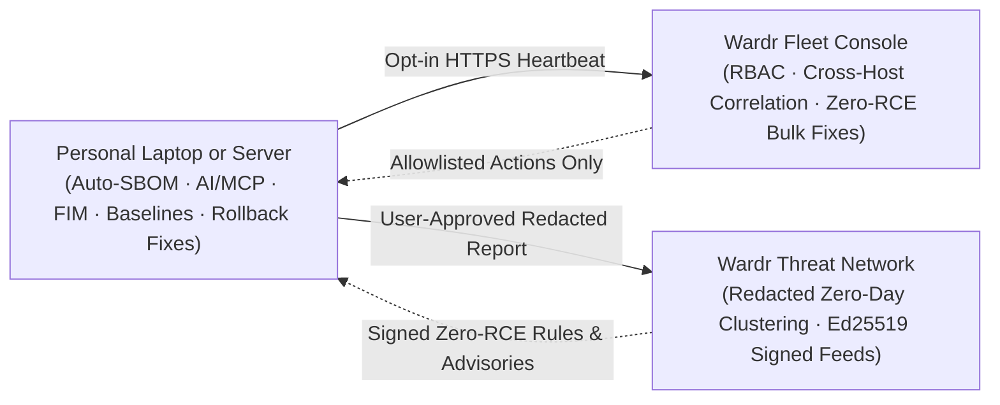

# Wardr Community

Wardr helps you harden a desktop or server you manage. The goal is to show
what a machine exposes, explain the evidence behind each finding, and make it
clear how to fix and verify security gaps. Community is free under the
[MIT License](LICENSE).

The installed application checks host settings, inventories local network
bindings, correlates selected security events, and matches supplied software
inventories to published advisories. It combines those findings into a
remediation plan. [Wardr homepage and demo](https://getwardr.com/)

## Project documentation

- [Architecture](docs/ARCHITECTURE.md) covers software components, Mermaid
  system and rollback diagrams, evidence and repair flows, local state, and
  trust boundaries.
- [Wardr Fleet Guide](docs/FLEET.md) covers the self-hosted RBAC Fleet
  control plane, Web Console, enrollment and bulk-remediation sequence
  diagrams, hardened daemon templates, and HTTP API.
- [Threat Network & Rapid-Defense Feeds](docs/THREAT_NETWORK.md) covers the
  zero-day immune loop diagram, client-side PII/secret redaction, zero-RCE
  Ed25519 feed schemas, and clustering intake server.
- [Development and operations](docs/DEVELOPMENT.md) covers running from
  source, troubleshooting, native checks, builds, and the release workflow.
- [Security policy](SECURITY.md) covers vulnerability reporting, release
  verification, and our [full Security Audit Report](docs/security-audit.md).
- [Privacy Policy](PRIVACY.md) and [Terms of Use](TERMS.md) document Wardr's
  local-first privacy guarantees, opt-in redacted telemetry, and authorized-use scope.
- [Signing handoff](docs/HANDOFF_SIGNING_MOVE.md) records the decision to sign
  Wardr's installers in this repository and the work left to do.
- [Company site repository](https://github.com/Luminary-Analytics/wardr-site)
  contains the public site and its download publishing workflow.



## Install

Download the native installer for Windows, macOS, or Linux. These installers
include the runtime and can install offline. [Download Wardr](https://getwardr.com/#release) ·
[Native installer guide](packaging/README.md)

To install from the wheel, use Python 3.11 or later and run these commands
from your downloads folder. [Set up pipx](https://pipx.pypa.io/stable/)

```console
pipx install ./wardr-0.3.1-py3-none-any.whl
wardr
```

To upgrade from v0.2.0, close Wardr, download the v0.3.1 wheel, and run
`pipx install --force ./wardr-0.3.1-py3-none-any.whl` once. Launch Wardr again
as the account whose security settings you want to check.

## Dashboard

Wardr prints a private single-use loopback launch link (exchanged once via
`POST /api/auth/exchange` for a session token). It scans on startup and hourly
while the dashboard service runs. Select **Run scan** to pick **Light**,
**Medium**, or **Heavy / Deep** scan depth with live progress, trade-off
warnings, and one-click **Fix & Protect All**.

- **Overview & Visual Security Report** provides a Red / Amber / Green Shield
  verdict, continuous sweeping radar, active threats panel, Protection Coverage
  meter (with transparent **Queued · Pending restart** and **Mark handled**
  dispositions), **3-Tier AI Protection** (Tier 1 Always-On Local Radar, Tier 2
  Free Cloud AI Offload with local PII redaction, and Tier 3 Heavy Local AI via
  Ollama), and an interactive printable RAG Visual Security Report.
- **Defense — What We Defend & Pen-Test Lab** combines a **Dual-View Threat
  Defense Matrix** (toggle between **Everyday view** and **Technical view** with
  MITRE ATT&CK / OWASP mappings) and an **Authorized Local Self-Pen-Test Lab**
  that runs 6 strictly local, non-destructive probes (exposed AI/database ports,
  infostealer secret-permission harvest, startup backdoors, `$PATH` hijacks,
  firewall boundaries, and a live SHA-256 tamper & threat-hunting canary) with
  Kill-Chain Attack Path analysis and one-click **Fix & Harden All**.
- **Defense — Software & Supply-Chain Scanner** scans local repositories,
  lockfiles, global npm modules, and runtimes for **30+ compromised npm packages**
  (including 2025 waves like `nx`, `chalk`/`debug`, `@ctrl/tinycolor`),
  malicious `postinstall` hooks, **React2Shell (CVE-2025-55182)**,
  **PHP-CGI / PHP2Shell (CVE-2024-4577)** + PHP webshells, **Next.js middleware
  bypass (CVE-2025-29927)**, **Log4Shell (CVE-2021-44228)**, and **Polyfill.io**,
  alongside CycloneDX + OSV + CISA KEV advisory matching.
- **Accounts, Google/Microsoft OAuth & What's New?** supports Wardr accounts
  (Google & Microsoft OAuth 2.0 PKCE `S256` + salted `scrypt` email auth),
  explicit Privacy Policy / Terms consent, strictly opt-in redacted telemetry
  with live payload preview, and a versioned **What's New?** modal after updates
  (plus `wardr serve --offline` for air-gapped security researchers).
- **Checklist** shows the risk, evidence, and next step for each check,
  including OS hardening, local credential permissions (`~/.ssh`, `~/.aws`,
  `~/.kube`, `~/.gnupg`, `~/.docker`), and local AI/MCP security hygiene.
  Supported permission repairs on macOS and Linux show a dry-run diff preview,
  save an atomic rollback snapshot, and verify automatically after applying.
  Any failed finding also offers **Report to Wardr**, which strips hostnames,
  usernames, home paths, IPs, emails, and secrets locally before previewing
  the redacted report for optional submission or offline JSON export.
- **Events** shows the monitor's available sources, persistent host baseline
  drift, and up to 2,000 retained local observations. Hunting alerts link to
  specific events, support declarative signed feed rules, and offer one-click
  redacted **Report to Wardr** escalation.
- **Reports** and **Defense** export HTML and JSON. Exports can contain the
  machine name, software versions, bindings, and event details.

## Update Wardr

Starting with v0.2.1, open **Updates** in the dashboard and choose **Check for
updates**. When a signed release is available, select **Update Wardr** to verify
and install it, then choose **Restart Wardr**. Use the new dashboard window or
the launch link printed in your terminal.

In-place updates require Wardr installed in a pipx or Python virtual
environment, with pip available in that environment or uv on `PATH`.
Download the wheel and use your package manager for releases that change
dependencies or when in-place updates are unavailable.

```console
wardr update --check
wardr update
```

The CLI checks explicitly and installs only when you run `wardr update`.
Restart any open Wardr process after a CLI update. On Windows, invoke the
environment's Python with `-m wardr update` to keep the Wardr launcher free
for replacement. [Update troubleshooting](docs/DEVELOPMENT.md#operate-and-troubleshoot)

## Offline mode

Start a dashboard session with public advisory downloads and Wardr release
checks disabled.

```console
wardr serve --offline
```

Local checks, software assessments from files, event monitoring, and report
exports work offline. Cached advisories remain available. For optional model
review, install and start [Ollama](https://ollama.com/download) locally. While
online, prepare Wardr's pinned Qwen2.5 1.5B model, which downloads about 986 MB.

```console
wardr model pull
wardr model status
wardr serve --offline
```

In **Defense → Plan**, select **Review with local AI**. Wardr passes anonymous
plan item numbers, categories, and priorities to the loopback model and presents
validated groups of existing tasks. It keeps the evidence, recommendations,
inventory, and raw event content out of the model request. For a fully offline
runtime configuration, disable Ollama's cloud features in Ollama.
[Ollama offline configuration](https://docs.ollama.com/faq#how-do-i-disable-ollamas-cloud-features)

## Servers

```console
wardr scan
wardr exposure
wardr surface
wardr inventory
wardr fim --init && wardr fim
wardr assess --auto
wardr assess --sbom inventory.json --advisories advisories.json
wardr fix --preview aws-credentials-permissions
wardr feed --import-bundle defense-v1.json --signature defense-v1.json.sig
wardr report-issue --finding ssh-directory-permissions --zero-day --out redacted.json
wardr plan --format html > wardr-plan.html
wardr watch
wardr service-template --platform systemd
wardr service-template --platform systemd --fleet
wardr fleet server --host 127.0.0.1 --port 8443
wardr fleet enroll --server https://fleet.example.com --token wf_enroll_... --tags prod,linux
wardr fleet agent --interval 60
wardr threat-network --host 127.0.0.1 --port 8787
wardr serve --no-browser --offline
```

## Teams & Fleet Management

Small core security teams can self-host **Wardr Fleet** with zero extra
dependencies (`wardr fleet server`) to monitor and harden servers and user
computers from one web console:

- **RBAC for core teams**: `admin`, `responder`, and `viewer` roles backed by
  PBKDF2-SHA256 operator credentials, session tokens, and an immutable SQLite
  audit log.
- **Short-lived enrollment tokens**: Mint bounded, revocable tokens with
  default host roles (`server` / `workstation`) and tags; each host receives a
  unique hashed device token (`0600` locally) that can be revoked in one click.
- **Cross-host correlation & zero-RCE bulk fixes**: Automatically correlates
  shared posture failures, exposed databases/AI ports, FIM tampering, and
  zero-day baseline-drift alerts across the fleet. Operators can queue strictly
  allowlisted actions (`scan`, `exposure`, `inventory`, `fim_check`,
  `apply_fix`, `undo_fix`) across hosts or tag groups—never arbitrary remote
  scripts—and export executive HTML/JSON compliance reports.

`wardr watch` emits new events as JSON Lines on stdout and coverage updates on
stderr. Use an existing service supervisor for continuous collection. The
dashboard always binds to IPv4 loopback. Keep its launch link private.

On Windows, launch a headless dashboard through the installed environment's
Python interpreter with `-m wardr serve --no-browser` so future updates can
replace the Wardr launcher.

`wardr advisories --refresh` downloads the public CISA catalog. The dashboard
offers a manual refresh when online or an opt-in six-hour schedule via
`wardr serve --auto-advisories`. Wardr sends no local inventory or event data in
that request. [CISA Known Exploited Vulnerabilities catalog](https://www.cisa.gov/known-exploited-vulnerabilities-catalog)

## Coverage

| Platform | Checks | Event sources |
| --- | --- | --- |
| macOS | Firewall, FileVault, Gatekeeper, System Integrity Protection, updates, SSH permissions | New TCP listeners and launch item changes |
| Windows | Firewall profiles, Defender, BitLocker, SMBv1, UAC, Secure Boot, Remote Desktop authentication, cached updates | New TCP listeners and selected System, Security, and Defender events |
| Linux | Firewall, ASLR, kernel link protections, AppArmor or SELinux, OpenSSH policy and permissions, cached APT or DNF advisories | New TCP listeners and selected SSH journal events |

OS permissions and available sources determine how much Wardr can verify.
The tools cover local evidence and published vulnerabilities. Wardr's
emerging-threat work focuses on detecting suspicious activity early.

Scans, retained events, the advisory cache, and computed software matches are
stored in the current user's Wardr data directory. The software matcher keeps
its result rather than the uploaded inventory or advisory files. Use
`wardr --state-dir <path> <command>` for a different local directory.

## Build and verify

Use a development virtual environment for local builds and tests.

```console
python -m pip install -e .
uv build
python -m unittest discover -s tests -v
```

The Blender scene, procedural render, and editable TripoSR mesh are in
`design/`. The installed app ships the rendered PNG.
[TripoSR project](https://github.com/VAST-AI-Research/TripoSR)

Wardr Community releases starting with v0.2.1 have Ed25519-signed manifests.
To verify a download manually, use the matching version's manifest and
detached signature, and a trusted public key obtained independently. Wardr
verifies downloads offline using PyCA cryptography without an OpenSSL
command. [Release downloads](https://getwardr.com/#release)

```console
wardr verify-release --manifest release.json --signature release.json.sig --public-key trusted.pem wardr-0.3.1-py3-none-any.whl
```

See the [security policy](SECURITY.md) for private vulnerability reporting and
release provenance.
