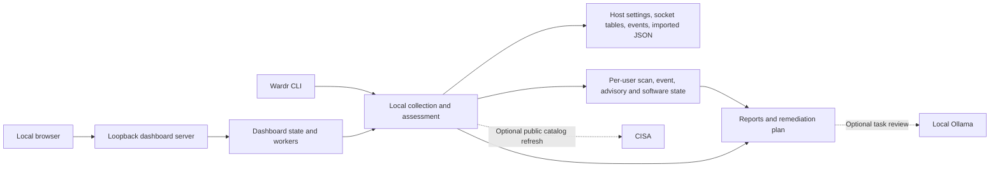

# Wardr architecture

Wardr Community helps people harden desktops and servers they manage. An
operator should be able to see what a check observed, understand the risk,
take an appropriate action, and verify the result. Wardr keeps that workflow
on the assessed host. The public website distributes releases and illustrates
the workflow with sample data. [Wardr homepage](https://getwardr.com/) ·
[Company site repository](https://github.com/Luminary-Analytics/wardr-site)

The Community release focuses on single-host posture, local exposure, selected
event patterns, and matching supplied software inventories to published
advisories. It requires Python 3.11 or newer and uses the Python standard
library at runtime. Operating-system tools and access vary by platform.

## Components and data flow

The desktop entry point starts a local Python HTTP server and opens the
dashboard, a packaged HTML, CSS, and JavaScript application. Headless commands
in `wardr/cli.py` call the same collection, assessment, and reporting modules.
The public site runs separately from the installed product.

| Area | Implementation | Output |
| --- | --- | --- |
| Desktop runtime | `wardr/server.py`, `wardr/state.py`, `wardr/static/` | Dashboard, background work, and local state |
| Device posture and repair | `wardr/checks.py` | Check ID, status, severity, evidence, risk, next step, and repair eligibility |
| Local exposure | `wardr/exposure.py` | TCP listeners, UDP bindings, bind scope, ownership where available, and source coverage |
| Event monitoring and hunting | `wardr/monitor.py`, `wardr/hunting.py` | Retained observations and rule-based alerts with evidence and review steps |
| Software assessment | `wardr/assessment.py`, `wardr/intel.py` | Version matches and gaps from imported CycloneDX and OSV data, with CISA context |
| Reporting and prioritization | `wardr/report.py`, `wardr/plan.py` | Scan and plan views with text, JSON, and HTML exports |
| Optional model review | `wardr/local_ai.py` | Suggested groups of existing plan tasks |
| Release verification | `wardr/release.py` | Ed25519 manifest validation and SHA-256 artifact verification |

At dashboard startup, Wardr loads saved scan and software assessment results,
starts the monitor, and requests a fresh scan and exposure snapshot. Device
scans repeat hourly while the dashboard runs. Exposure can be refreshed on
demand. The monitor defaults to polling every 30 seconds. Background work is
coordinated in `WardrState` so a scan and a repair cannot change the same
checklist at the same time.

### How to interpret the evidence

- Posture checks report `pass`, `fail`, `unknown`, or `not_applicable`.
  A missing permission, unsupported state, or stale input can leave a check
  unknown. Patch checks can use cached OS data.
- Exposure comes from local socket tables. macOS uses `netstat`, Linux reads
  the current network namespace through `/proc/net`, and Windows uses
  PowerShell. Loopback, specific-interface, and wildcard bindings describe
  local socket scope. Remote reachability also depends on firewall and
  network policy.
- The monitor looks for new non-loopback TCP listeners and selected
  platform events. The hunting rules evaluate retained events in a
  24-hour window and link alerts to the underlying observations. Polling
  frequency, log availability, and retention affect what can be observed.
  Alerts are investigation leads.
- Software matches cover the package identities and versions in the
  imported CycloneDX inventory and the supplied OSV advisory records.
  The matcher handles enumerated versions, SemVer ranges, and numeric
  PyPI release ranges. It reports gaps for unassessed ranges and
  packages without matching advisory entries. CISA catalog entries
  raise the priority of an existing version match.
- The remediation plan combines failed or unknown device checks, software
  findings, event alerts, and non-loopback bindings for review. Each
  task includes the available evidence, an action, and a verification
  step. The dashboard and CLI use the same plan builder.

### One-click repair

The installed dashboard offers **Review fix** only when the latest scan found
an eligible failure. After confirmation, the server accepts the finding ID
and dispatches it to the allowlisted repair in `checks.py`. Wardr rechecks
the target after the change and updates that finding.

Automatic repair is limited to the current unprivileged user's SSH
permissions on macOS and Linux. It can remove group and other access from
`~/.ssh` and standard identity files, or group and other write access from
standard authorized-keys files. The repair checks ownership, avoids following
symlinks, and requires manual review when ownership, file identity, or ACLs
cannot be verified. Other findings include guidance for manual remediation.

## Local state

| Location | Default |
| --- | --- |
| macOS | `~/Library/Application Support/Wardr` |
| Windows | `%LOCALAPPDATA%\Wardr`, with a fallback to the user's `AppData\Local\Wardr` |
| Linux | `$XDG_STATE_HOME/wardr` when the variable is an absolute path, otherwise `~/.local/state/wardr` |

Use `wardr --state-dir <path> <command>` to select another location. On POSIX
systems, the state directory must belong to the running account and must
exclude group and other write access.

| File | Contents |
| --- | --- |
| `latest-scan.json` | Latest valid device scan for this hostname |
| `monitor-events.sqlite3` | Up to 180 retained observations |
| `software-assessment.json` | Computed software findings and coverage from the latest import |
| `cisa-kev.json` | Cached public CISA Known Exploited Vulnerabilities catalog |

The software matcher stores its result and uses the imported documents during
assessment. Exposure is a runtime snapshot. Reports and plans are generated
on demand and saved when you export them. The state and exported results may
contain device names, ports, software versions, and event details.

## Trust and network boundaries

The dashboard binds to IPv4 loopback. Its private launch URL carries a
per-process token in the URL fragment. The frontend removes the fragment
from browser history and keeps the token in the current tab's session
storage when available. Data and action requests carry that token. The
server checks the Host header and also requires the exact dashboard origin for
POST requests. Keep the launch link private and use the service locally.

The dashboard serves its own assets and restricts resource loading with a
Content Security Policy. Route groups in `server.py` are internal to the
bundled dashboard.

| Local route | Role |
| --- | --- |
| `GET /api/status`, `GET /api/defense` | Scan, monitor, advisory, exposure, hunting, assessment, and plan state |
| `GET /report.html`, `GET /report.json`, `GET /plan.html`, `GET /plan.json` | Render or download current results |
| `POST /api/scan`, `POST /api/exposure`, `POST /api/intel/refresh` | Start the named refresh |
| `POST /api/software/assess` | Validate a bounded JSON import and save the computed result |
| `POST /api/fix` | Apply an eligible repair by check ID |
| `GET /api/local-ai`, `POST /api/local-ai/review` | Read model readiness and request an optional review |

CISA refresh is opt-in. It downloads the public catalog without including
local inventory or event data. `wardr serve --offline` disables dashboard
catalog downloads and retains access to the existing cache. See the
[development and operations guide](DEVELOPMENT.md) for the model workflow.

Wardr's optional review connects to Ollama at `127.0.0.1:11434` and checks the
pinned manifest digest for `qwen2.5:1.5b`. It sends temporary item numbers,
task categories, and priorities. Wardr validates the selected items against
the plan and displays predefined review guidance. The model cannot authorize
or execute a repair. Preparing the model is a separate, explicit operation.

## Coverage limits

Wardr reports the parts of the system it could observe. The output depends on
the current user's permissions, available OS tools and logs, and the quality
and freshness of the supplied assessment records. The socket inventory
covers local bindings, the event monitor samples selected signals, and the
software assessment covers the supplied inventory and advisory data. Use
the reported coverage when deciding what needs additional investigation.
