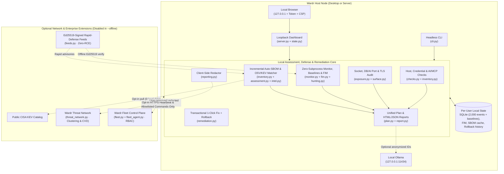
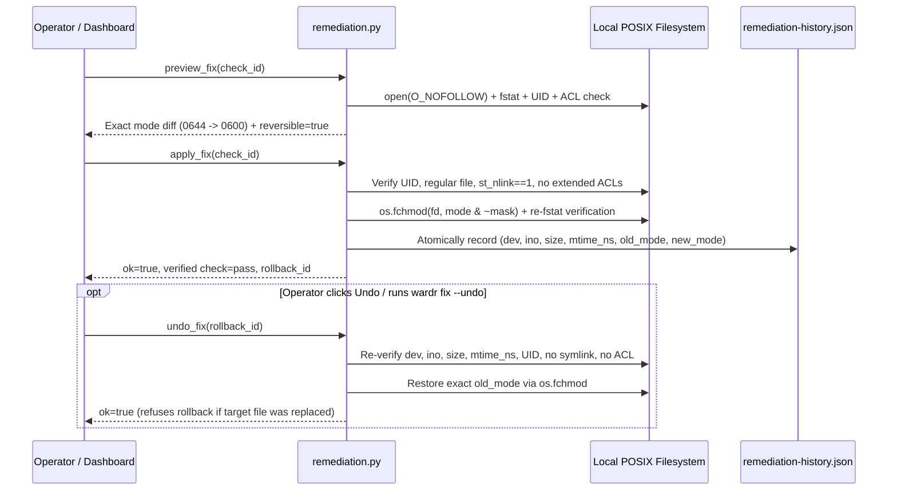

# Wardr architecture

Wardr Community helps people harden desktops and servers they manage. An
operator should be able to see what a check observed, understand the risk,
take an appropriate action, and verify the result. Wardr keeps that workflow
on the assessed host. The public website distributes releases and illustrates
the workflow with sample data. [Wardr homepage](https://getwardr.com/) ·
[Company site repository](https://github.com/Luminary-Analytics/wardr-site)

The Community release focuses on single-host posture, local exposure, selected
event patterns, and matching supplied software inventories to published
advisories. It requires Python 3.11 or newer. Wardr uses PyCA cryptography
for Ed25519 verification. Operating-system tools and access vary by platform.

## Components and data flow

See also the dedicated [Wardr Fleet Guide](FLEET.md) and [Threat Network & Rapid-Defense Feeds Guide](THREAT_NETWORK.md) for sequence diagrams, RBAC matrices, and deployment topology.

The desktop entry point starts a local Python HTTP server and opens the
dashboard, a packaged HTML, CSS, and JavaScript application. Headless commands
in `wardr/cli.py` call the same collection, assessment, and reporting modules.
The public site runs separately from the installed product.

| Area | Implementation | Output |
| --- | --- | --- |
| Desktop runtime | `wardr/server.py`, `wardr/state.py`, `wardr/static/` | Dashboard, background work, and local state |
| Device posture and repair | `wardr/checks.py`, `wardr/remediation.py` | Check ID, status, severity, evidence, risk, next step, dry-run preview, and rollback-safe allowlisted repairs |
| Local exposure and surface audit | `wardr/exposure.py`, `wardr/surface.py` | TCP/UDP bindings, bind scope, risky exposed database/AI ports, and loopback TLS checks |
| Event monitoring, FIM, and hunting | `wardr/monitor.py`, `wardr/fim.py`, `wardr/hunting.py` | Retained observations (up to 2,000), persistent host baselines, SHA-256 config FIM, and built-in + signed declarative hunting alerts |
| Software & AI surface assessment | `wardr/inventory.py`, `wardr/assessment.py`, `wardr/intel.py` | Incremental CycloneDX auto-discovery, AI/MCP hygiene checks, OSV + Rapid-Defense Feed matching, and CISA KEV context |
| Signed Rapid-Defense Feeds | `wardr/feeds.py` | Offline/HTTPS Ed25519-verified declarative rules, rapid advisories, and allowlisted mitigation IDs (zero remote code execution) |
| Sanitized central reporting & Threat Network | `wardr/reporting.py`, `wardr/threat_network.py` | Opt-in client-side PII/secret redaction, preview/export/HTTPS submission, and self-hostable zero-day clustering + signed feed publishing |
| Self-hosted Fleet management | `wardr/fleet.py`, `wardr/fleet_agent.py`, `wardr/static/fleet.*` | SQLite + RBAC (`admin`/`responder`/`viewer`) control plane, enrollment tokens, cross-host correlation, zero-RCE allowlisted bulk command queue, executive compliance exports, and lightweight check-in agent |
| Continuous server templates | `wardr/service.py` | Hardened `systemd`, `launchd`, and Windows scheduled-task templates for `wardr watch` and `wardr fleet agent` |
| Reporting and prioritization | `wardr/report.py`, `wardr/plan.py` | Scan and plan views with text, JSON, and HTML exports |
| Optional model review | `wardr/local_ai.py` | Suggested groups of existing plan tasks |
| Release verification | `wardr/release.py` | Ed25519 manifest validation and SHA-256 artifact verification |
| Application updates | `wardr/updater.py`, `wardr/update_session.py` | Signed release checks, isolated installation, and dashboard update state |

At dashboard startup, Wardr loads saved scan and software assessment results,
starts the monitor, and requests a fresh scan and exposure snapshot. Device
scans repeat hourly while the dashboard runs. Exposure can be refreshed on
demand. The monitor defaults to polling every 30 seconds. Background work is
coordinated in `WardrState` so a scan and a repair cannot change the same
checklist at the same time.

### How to interpret the evidence

- Posture checks report `pass`, `fail`, `unknown`, or `not_applicable`.
  A missing permission, unsupported state, or stale input can leave a check
  unknown. Patch checks can use cached OS data.
- Exposure comes from local socket tables. macOS uses `netstat`, Linux reads
  the current network namespace through `/proc/net`, and Windows uses
  PowerShell. Loopback, specific-interface, and wildcard bindings describe
  local socket scope. Remote reachability also depends on firewall and
  network policy.
- The monitor looks for new non-loopback TCP listeners and selected
  platform events. The hunting rules evaluate retained events in a
  24-hour window and link alerts to the underlying observations. Polling
  frequency, log availability, and retention affect what can be observed.
  Alerts are investigation leads.
- Software matches cover the package identities and versions in the
  imported CycloneDX inventory and the supplied OSV advisory records.
  The matcher handles enumerated versions, SemVer ranges, and numeric
  PyPI release ranges. It reports gaps for unassessed ranges and
  packages without matching advisory entries. CISA catalog entries
  raise the priority of an existing version match.
- The remediation plan combines failed or unknown device checks, software
  findings, event alerts, and non-loopback bindings for review. Each
  task includes the available evidence, an action, and a verification
  step. The dashboard and CLI use the same plan builder.

### Transactional one-click repair & rollback

The installed dashboard offers **Review fix** only when the latest scan found
an eligible failure. Before modifying anything, the dashboard fetches
`POST /api/fix/preview` to show the exact target paths and octal mode changes
(for example `0644 → 0600`). After confirmation, `wardr/remediation.py` saves
an atomic rollback snapshot, applies the allowlisted permission change via
`os.fchmod`, and independently re-verifies the check.

Automatic repair covers unprivileged user-owned credential targets on macOS
and Linux: `~/.ssh` (directory, standard identity files, and authorized-keys
files), `~/.aws/credentials` and `~/.aws/config`, `~/.kube/config`, `~/.gnupg`,
and `~/.docker/config.json`. Every repair enforces `O_NOFOLLOW`, ownership
verification, single hard-link checks, and absence of extended ACLs. Rollback
additionally verifies `st_dev`, `st_ino`, `st_size`, and `st_mtime_ns` to
protect against file replacement and Linux ext4 inode reuse. Other findings
include guidance for manual remediation.

## Local state

| Location | Default |
| --- | --- |
| macOS | `~/Library/Application Support/Wardr` |
| Windows | `%LOCALAPPDATA%\Wardr`, with a fallback to the user's `AppData\Local\Wardr` |
| Linux | `$XDG_STATE_HOME/wardr` when the variable is an absolute path, otherwise `~/.local/state/wardr` |

Use `wardr --state-dir <path> <command>` to select another location. On POSIX
systems, the state directory must belong to the running account and must
exclude group and other write access.

| File | Contents |
| --- | --- |
| `latest-scan.json` | Latest valid device, credential, and AI/MCP posture scan for this hostname |
| `monitor-events.sqlite3` | Up to 2,000 retained observations plus persistent host baselines (`baselines` table) |
| `fim-baseline.json` | Saved SHA-256 baseline digests and modes for File Integrity Monitoring |
| `inventory-cache.json` | Incremental mtime/size-fingerprinted CycloneDX 1.5 auto-SBOM cache |
| `software-assessment.json` | Computed software findings and coverage from the latest auto or imported assessment |
| `remediation-history.json` | Bounded history (last 50) of transactional fixes and rollback snapshots |
| `cisa-kev.json` | Cached public CISA Known Exploited Vulnerabilities catalog |
| `defense-feed.json` | Locally cached, Ed25519-verified Rapid-Defense Feed (declarative rules & rapid advisories) |
| `submitted-reports.json` | Local receipts of user-approved redacted central vulnerability reports |
| `fleet-credentials.json` | `0600` per-host Fleet enrollment credentials (only when enrolled via `wardr fleet enroll`) |
| `fleet/fleet.sqlite3` | Fleet control-plane database (only when running `wardr fleet server`) |
| `threat-network/threat-network.sqlite3` | Threat Network intake & cluster store (only when running `wardr threat-network`) |

The software matcher stores its result and uses the imported documents during
assessment. Exposure is a runtime snapshot. Reports and plans are generated
on demand and saved when you export them. The state and exported results may
contain device names, ports, software versions, and event details.

## Trust and network boundaries

The dashboard binds to IPv4 loopback. Its private launch URL carries a
per-process token in the URL fragment. The frontend removes the fragment
from browser history and keeps the token in the current tab's session
storage when available. Data and action requests carry that token. The
server checks the Host header and also requires the exact dashboard origin for
POST requests. Keep the launch link private and use the service locally.

The dashboard serves its own assets and restricts resource loading with a
Content Security Policy. Route groups in `server.py` are internal to the
bundled dashboard.

| Local route | Role |
| --- | --- |
| `GET /api/status`, `GET /api/defense` | Scan, monitor, advisory, exposure, hunting, assessment, and plan state |
| `GET /report.html`, `GET /report.json`, `GET /plan.html`, `GET /plan.json` | Render or download current results |
| `POST /api/scan`, `POST /api/exposure`, `POST /api/intel/refresh` | Start the named refresh |
| `POST /api/software/assess` | Validate a bounded JSON import and save the computed result |
| `POST /api/fix`, `POST /api/fix/preview`, `POST /api/fix/undo`, `GET /api/remediation` | Dry-run preview, apply allowlisted repair with rollback snapshot, undo, and view history |
| `POST /api/inventory/scan`, `GET /api/feed` | Run incremental auto-SBOM assessment and inspect verified Rapid-Defense Feed status |
| `POST /api/report/preview`, `POST /api/report/submit` | Build client-redacted report preview and optionally submit over HTTPS (disabled in `--offline`) |
| `GET /api/local-ai`, `POST /api/local-ai/review` | Read model readiness and request an optional review |
| `GET /api/update`, `POST /api/update/check`, `POST /api/update/install`, `POST /api/update/restart` | Read update status, confirm each release action, and restart the dashboard |

CISA refresh is opt-in. It downloads the public catalog without including
local inventory or event data. `wardr serve --offline` disables dashboard
catalog downloads and release checks. The existing cache remains available.
See the [development and operations guide](DEVELOPMENT.md) for the model
workflow.

Wardr's optional review connects to Ollama at `127.0.0.1:11434` and checks the
pinned manifest digest for `qwen2.5:1.5b`. It sends temporary item numbers,
task categories, and priorities. Wardr validates the selected items against
the plan and displays predefined review guidance. The model cannot authorize
or execute a repair. Preparing the model is a separate, explicit operation.

### Release updates

The dashboard and CLI check for releases only on request. The updater fetches
the Community manifest and its detached, versioned Ed25519 signature over
HTTPS from `getwardr.com`. It verifies the exact manifest bytes against the
public key packaged with the running app. For a newer release, it downloads
the versioned wheel and validates its SHA-256 digest, size, and package
metadata before calling the isolated environment's installer. Update
requests send no device findings, inventory, or event data.

An installation lock serializes dashboard and CLI installs in the same
environment. The updater passes only the verified wheel to pip or uv and
installs without package-index access. Dependency changes require a manual
upgrade. The installer replaces the package in its current environment and
keeps the per-user Wardr data directory. The dashboard reports the running
and installed versions separately until the user restarts it.

## Coverage limits

Wardr reports the parts of the system it could observe. The output depends on
the current user's permissions, available OS tools and logs, and the quality
and freshness of the supplied assessment records. The socket inventory
covers local bindings, the event monitor samples selected signals, and the
software assessment covers the supplied inventory and advisory data. Use
the reported coverage when deciding what needs additional investigation.
