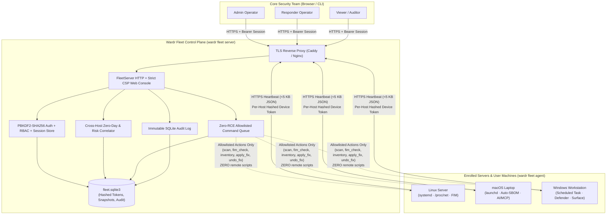
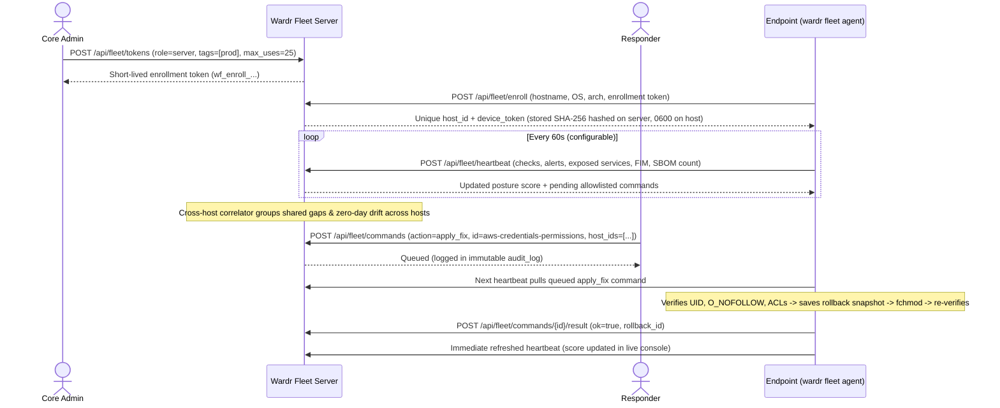

# Wardr Fleet Operations & Architecture Guide

**Wardr Fleet** is an open-core, zero-extra-dependency control plane, check-in agent, and bundled web console built directly into Wardr (`v0.3.1+`). It is designed so a small core security or IT team (1–5 operators) can monitor, correlate, and safely harden fleets of Linux, macOS, and Windows servers and user computers—without giving any remote server arbitrary code execution on endpoints.

## Architecture and trust boundaries



### Zero-RCE control-plane guarantee

Wardr Fleet enforces a strict **zero-remote-code-execution boundary** on both the server (`wardr/fleet.py`) and every endpoint (`wardr/fleet_agent.py`):

- The control plane can **never** dispatch arbitrary shell commands, scripts, or executable payloads.
- Every queued action is validated against a compiled allowlist: `scan`, `exposure`, `inventory`, `fim_check`, `apply_fix` (restricted strictly to locally audited `remediation.ALL_FIX_IDS`), and `undo_fix`.
- Even if a Fleet server or operator account were compromised, endpoints reject any unallowlisted action or parameter locally.

## Enrollment and 1-click bulk remediation flow



## Core-team RBAC matrix

| Capability | `admin` | `responder` | `viewer` |
| :--- | :---: | :---: | :---: |
| View Fleet KPIs, hosts, cross-host correlations & host details | Yes | Yes | Yes |
| View immutable audit log & export HTML/JSON compliance reports | Yes | Yes | Yes |
| Queue allowlisted scans, FIM checks, Auto-SBOM & 1-click fixes/rollbacks | Yes | Yes | No |
| Mint & revoke short-lived enrollment tokens | Yes | No | No |
| Add core team operators (`admin` / `responder` / `viewer`) | Yes | No | No |
| Revoke compromised or decommissioned host device tokens | Yes | No | No |

## Quick start

### 1. Start the Fleet control plane

```console
wardr --state-dir /var/lib/wardr-fleet fleet server --host 127.0.0.1 --port 8443
```

On first launch, Wardr creates the SQLite store (`fleet/fleet.sqlite3`) and prints a generated bootstrap administrator password. Open the Fleet Web Console (`http://127.0.0.1:8443/` locally, or behind TLS in production) to sign in, add additional `responder`/`viewer` team members, and generate enrollment tokens.

### 2. Put TLS in front for production fleets

Remote endpoints enforce **HTTPS** (`wardr fleet enroll` refuses plain HTTP for non-loopback hosts). Place a minimal TLS reverse proxy such as Caddy or Nginx in front of `127.0.0.1:8443`:

```caddyfile
fleet.example.com {
    reverse_proxy 127.0.0.1:8443
}
```

### 3. Enroll servers and user computers

Run the copy-paste enrollment command printed in **Enroll & Team**, then run a single check-in or install a hardened background daemon:

```console
wardr fleet enroll --server https://fleet.example.com --token wf_enroll_... --role server --tags prod,linux
wardr fleet checkin
wardr service-template --platform systemd --fleet --interval 60
```

Supported continuous service templates (`--fleet`):

- `systemd` — Linux servers (`NoNewPrivileges=yes`, `ProtectSystem=strict`, `MemoryMax=128M`, `CPUQuota=10%`)
- `launchd` — macOS laptops and servers (`~/Library/LaunchAgents/com.getwardr.fleet-agent.plist`)
- `windows` — Windows workstations and servers (PowerShell Scheduled Task registration)

## HTTP API reference

| Route | Auth | Purpose |
| :--- | :--- | :--- |
| `GET /` | Public | Bundled strict-CSP Fleet Web Console |
| `GET /api/fleet/health` | Public | Health check & high-level fleet summary |
| `POST /api/fleet/login`, `POST /api/fleet/logout` | Public / Session | Operator sign-in and session revocation |
| `POST /api/fleet/enroll` | Enrollment token | Enroll a host and issue a per-device token |
| `POST /api/fleet/heartbeat` | Device Bearer token | Submit compact host snapshot and pull queued allowlisted commands |
| `POST /api/fleet/commands/{id}/result` | Device Bearer token | Report verified outcome and optional `rollback_id` |
| `GET /api/fleet/overview` | Any operator | KPIs, cross-host correlations, filterable host list (`?tag=&os=&status=`) |
| `GET /api/fleet/hosts/{host_id}` | Any operator | Full host snapshot, checks, alerts, exposed services, command history |
| `POST /api/fleet/commands` | `admin` or `responder` | Queue allowlisted command for specific `host_ids`, `tag`, or whole fleet |
| `GET /api/fleet/tokens`, `POST /api/fleet/tokens`, `POST /api/fleet/tokens/{id}/revoke` | `admin` | Manage short-lived enrollment tokens |
| `GET /api/fleet/operators`, `POST /api/fleet/operators` | `admin` | Manage core team RBAC accounts |
| `POST /api/fleet/hosts/{host_id}/revoke` | `admin` | Immediately revoke a host's device token and cancel queued commands |
| `GET /api/fleet/audit` | Any operator | Read immutable audit log |
| `GET /api/fleet/report.html`, `GET /api/fleet/report.json` | Any operator | Executive compliance HTML/JSON exports (`?download=1` to save) |
