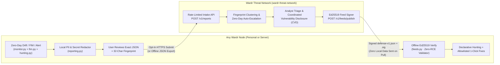

# Wardr Threat Network & Rapid-Defense Feeds

Wardr's **Collective Immune System** (`wardr/reporting.py`, `wardr/threat_network.py`, and `wardr/feeds.py`) lets individuals and organizations turn local zero-day sightings into verified, community-wide defenses—without forced telemetry, without leaking sensitive host data, and without remote code execution.

## Zero-day immune loop



## Client-side redaction guarantees (`Report to Wardr`)

Before any report is exported or submitted via `wardr report-issue` or the dashboard's **Report to Wardr** modal, `wardr/reporting.py` strips local identifiers automatically and displays both the exact redacted JSON and redaction count to the user:

| Category stripped | Replaced with |
| :--- | :--- |
| Hostname (full and short domain) | `<HOST>` |
| Local account usernames (`USER`, `USERNAME`, `LOGNAME`, POSIX `pwd`) | `<USER>` |
| Home directory paths (`/Users/...`, `/home/...`, `C:\Users\...`) | `<HOME>` |
| IPv4 and IPv6 addresses | `<IP>` |
| Email addresses | `<EMAIL>` |
| Private key PEM blocks, Bearer tokens, JWTs, OpenAI/Anthropic/GitHub/Google/AWS/Slack/HF API keys | `<REDACTED_SECRET>` |

Each report receives a deterministic 32-character SHA-256 **structural fingerprint** so the Threat Network can cluster identical anomalies across independent hosts without ever storing raw IPs or secrets. In `--offline` mode, HTTPS submission is strictly blocked while local JSON export (`--out redacted.json`) remains available for air-gapped teams.

## Ed25519-signed Rapid-Defense Feeds (Zero-RCE schema)

Rapid-Defense Feeds (`wardr/feeds.py`) deliver rapid detection rules and OSV-compatible emerging advisories without requiring a full application upgrade:

- **Cryptographic verification**: Every feed bundle (`defense-v1.json`) requires a 64-byte detached Ed25519 signature (`defense-v1.json.sig`) verified offline using PyCA `cryptography` against Wardr's pinned public key (`wardr/keys/release.pem`) or an explicit trusted key.
- **Declarative rules only (Zero ReDoS, Zero RCE)**: Rules use strictly bounded case-insensitive substring predicates (`event` or `burst` over bounded time windows)—never arbitrary code, shell commands, or unbounded regular expressions.
- **Allowlisted mitigations only**: Optional `mitigation_id` fields are validated against `feeds.ALLOWED_MITIGATIONS` (only locally compiled, audited Wardr repair IDs). Even a validly signed feed with an unlisted `mitigation_id` is rejected.

### Example Rapid-Defense Feed bundle

```json
{
  "schema_version": 1,
  "channel": "community",
  "version": "2026.11.21-1",
  "published_at": "2026-11-21T08:00:00+00:00",
  "rules": [
    {
      "id": "rapid-unexpected-listener",
      "title": "Emerging zero-day listener indicator",
      "severity": "critical",
      "confidence": "high",
      "summary": "Community-verified indicator for an actively exploited backdoor port.",
      "actions": ["Isolate the listening port and inspect the owning binary immediately."],
      "mitigation_id": "ssh-directory-permissions",
      "match": {
        "kind": "event",
        "source": "TCP listeners",
        "detail_contains": [":31337"]
      }
    }
  ],
  "advisories": [
    {
      "id": "WARDR-2026-0001",
      "modified": "2026-11-21T08:00:00Z",
      "summary": "Rapid emerging advisory prior to upstream CVE publication",
      "affected": [
        {
          "package": { "ecosystem": "PyPI", "name": "example-pkg" },
          "versions": ["1.2.3"]
        }
      ]
    }
  ]
}
```

## Operator CLI & self-hosted server

### Client commands

```console
# Preview a strictly redacted zero-day report
wardr report-issue --finding ssh-directory-permissions --zero-day

# Export a redacted report locally (air-gap friendly)
wardr report-issue --custom "Novel process anomaly" --zero-day --out redacted.json

# Sign, import, or inspect a Rapid-Defense Feed
wardr feed --sign defense-v1.json --signing-key feed-ed25519.pem --signature defense-v1.json.sig
wardr feed --import-bundle defense-v1.json --signature defense-v1.json.sig --public-key feed-public.pem
wardr feed
```

### Self-hosted Threat Network server

```console
wardr --state-dir /var/lib/wardr-tn threat-network \
  --host 127.0.0.1 --port 8787 \
  --signing-key /etc/wardr/feed-ed25519.pem
```

| Route | Auth | Purpose |
| :--- | :--- | :--- |
| `POST /v1/reports` | Public (rate-limited) | Ingest validated redacted report, cluster by fingerprint, auto-escalate spikes |
| `GET /v1/health` | Public | Service health, cluster counts, and active feed version |
| `GET /feeds/defense-v1.json` | Public | Serve active signed Rapid-Defense Feed bundle |
| `GET /feeds/defense-v1.json.sig` | Public | Serve detached 64-byte Ed25519 signature |
| `GET /v1/clusters` | Operator Bearer | List clustered vulnerability/zero-day candidates sorted by escalation |
| `POST /v1/clusters/{fp}/status` | Operator Bearer | Update CVD triage status (`escalated`, `vendor_notified`, `cve_assigned`, `mitigated`, `closed`) |
| `POST /v1/feeds/publish` | Operator Bearer | Validate declarative schema, sign with Ed25519, and atomically publish active feed |
